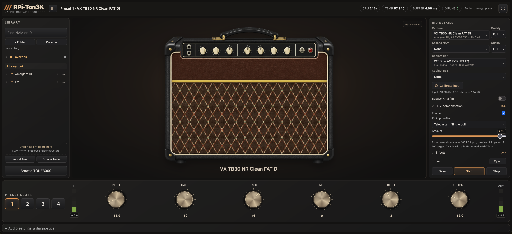

# RPiT3K — Native NAM guitar processor for Raspberry Pi & Pisound

**Public preview · Linux / ALSA · Raspberry Pi 5 tested · MIT**

RPiT3K is an independent open-source guitar processor inspired by the [TONE3000 × Daisy DIY Pedal](https://github.com/tone-3000/t3k-diy-pedal). It turns a Raspberry Pi equipped with [Blokas Pisound](https://blokas.io/pisound/) into a standalone neural amplifier and cabinet processor, controlled from a browser.

The goal is a small, reproducible, offline-capable guitar rig rather than a general-purpose plugin host: native NAM inference, a predictable audio path, low buffering, persistent presets and transparent engineering measurements. The Raspberry Pi implementation does not run the Daisy firmware or its embedded inference engine.

**[Installation and user guide](README-PISOUND.md)** · **[Technical report and test reproduction](rpi/README.md)** · **[Original Daisy documentation](README-DAISY.md)**

## Web interface



*Actual RPiT3K interface running on the development hardware. The screenshot illustrates a live preset with NAM and cabinet IR selected; it is not a mockup.*

## Results at a glance

| Measurement | Observed result | Scope |
| --- | ---: | --- |
| Mean DSP processing time | 300.81 µs / 22.56% of period | Earlier Pi 5 build, one NAM + IR |
| Worst observed DSP time | 362.723 µs / 27.20% of period | Same short measurement |
| ALSA recovery events / late DSP blocks | 0 / 0 | 11,253 blocks, approximately 15 s |
| NAM relative RMS null residual | −97.33 to −97.70 dB | Full and Lite versus default upstream Core |
| IR convolution maximum absolute error | 3.97309 × 10⁻⁷ | Latest native DSP test, up to 48,000 taps |
| IR resampling relative residual | −92.59 to −105.79 dB | Three source sample rates |
| Latest native DSP regression suite | PASS (1/1, 0.25 s) | Expander, convolution, tuner |
| Latest bypass verification | PASS | Gain, EQ, mute and clipping |

These are developer-reported results obtained on actual Raspberry Pi hardware, not independent certification or CI results. The performance and NAM/IR comparison measurements precede the latest meter and expander additions. No new integrated real-time benchmark is claimed for the current revision.

## Features

- Native mono NAM captures using pinned NeuralAmpModelerCore, including compatible A2 slimmable Full and Lite models.
- Optional second NAM and independent cabinet IR. No conversion to Daisy .namb format.
- Mono WAV IR up to one second at 48 kHz, partitioned FFT convolution and windowed-sinc sample-rate conversion.
- Live input/output gains, three-band EQ and soft-knee input-keyed noise reduction.
- Chromatic tuner with muted output; input/output digital peak meters, CPU, temperature, nominal ALSA buffer and recovery counter.
- Four persistent presets, nested local file library, responsive browser interface and offline playback.
- systemd startup, optional physical Pisound button preset cycling and fallback NetworkManager hotspot.
- Experimental TONE3000 account browsing/import, disabled by default in new service installations pending verification and API compliance.

## Architecture

```text
Pisound ADC (left channel)
    ├── Input peak meter
    ├── Noise-reduction detector ────────────────────────────────┐
    └── Input gain → NAM 1 → optional NAM 2 → optional IR → EQ   │
                                             → Output gain → attenuation
                                             → finite guard / clamp
                                             → output peak meter
                                             → Pisound DAC (dual mono)

Browser → Python HTTP controller → native C++ engine
                 ├── local presets and model library
                 ├── live controls (private stdin pipe)
                 ├── level telemetry (nonblocking pipe)
                 └── optional cloud client (outside audio engine)
```

The native C++20 engine uses ALSA directly at 48 kHz with stereo S32_LE interleaving, left-channel input and dual-mono output. No JACK, PipeWire or LV2 host is required. The controller requests SCHED_FIFO priority 60 with normal-priority fallback. ALSA underrun/overrun or suspend recovery restarts both streams. Model and preset changes currently restart audio; switching is not gapless.

The inference backend is [NeuralAmpModelerCore](https://github.com/sdatkinson/NeuralAmpModelerCore) at commit `d3189ed482ded880c128bf312941266c4fa5ceec`, built with float32 sample interface and A2 fast-path enabled. The original project's three-band EQ is reused. Cabinet convolution, WAV resampling, tuner, expander, ALSA and web control are native implementation components. The browser is not in the real-time audio path.

| Control | Range / behavior |
| --- | --- |
| Input | 0–2× linear gain |
| Bass / Mid / Treble | ±20 / ±15 / ±10 dB |
| Output | 0–1× linear gain |
| Gate | OFF or −80 to −30 dBFS |
| Buffer | 64, 128, 256, 512 frames; 2–4 periods |
| Bypass | Skips NAM/IR, retains gain, EQ and enabled expander |

### Noise reduction

The latest implementation is a downward expander, not an all-or-nothing gate. It detects the raw input and attenuates the processed output, including residual model noise. The curve uses a 6 dB soft knee, 4:1 downward expansion, up to 90 dB attenuation, approximately 30 ms peak-envelope decay, 1 ms gain opening and 350 ms gain closing time constants. No lookahead. The target is recalculated every 16 samples; gain is smoothed sample by sample. OFF bypasses the expander.

For a constant −45 dBFS detector level, theoretical steady-state gain is −2.25 dB at threshold −45 and −4 dB at threshold −44: a difference of 1.75 dB, rather than a binary mute. The automated test checks this transition as well as opening, release, deep attenuation and OFF transparency. Musical sustain and noise suppression with real pickups still need listening tests. Noise generated after the DAC cannot be removed digitally.

## Experimental effects and calibration

The latest revision adds an Amount-controlled compressor with selectable PRE/POST NAM position and a mono four-line feedback delay network reverb with Spring-style, Plate-style and Room voicings, Mix and Decay (0.2–5 s). These are algorithmic voicings, not physical spring/plate models or measured IRs. Both effects default to OFF in existing presets and are adjustable live. The reverb follows noise reduction so the expander does not cut its tail. Final output gain follows both effects. Calibrate Input reads NAM input_level_dbu metadata and computes 10^((ADC reference − model reference)/20); the suggested +1.14 dBu Pisound reference is nominal at minimum gain, not measured. Missing metadata or out-of-range compensation is rejected. The Pi 5 native FX regression tests now pass (see below). Historical NAM + IR real-time measurements still do not cover active FX.

## Technical validation

### 1. Test platform and real-time performance

Raspberry Pi 5, 4 GB RAM, Raspberry Pi OS Lite 64-bit (Debian Trixie), Blokas Pisound, 48 kHz, 64 frames × 3 periods. Earlier benchmark used a commercial 48 kHz slimmable NAM capture and mono cabinet IR (identifiers and model hash in the [technical report](rpi/README.md)); neither asset is distributed.

Three consecutive telemetry windows, guitar idle:

| Window | Mean DSP (µs) | Maximum (µs) | Blocks | Late | Cumulative recoveries | Clipped samples |
| --- | ---: | ---: | ---: | ---: | ---: | ---: |
| 1 | 300.477 | 340.761 | 3751 | 0 | 0 | 0 |
| 2 | 300.767 | 362.723 | 3751 | 0 | 0 | 0 |
| 3 | 301.179 | 353.724 | 3751 | 0 | 0 | 0 |

At 48 kHz a 64-frame period lasts 1.333 ms. The mean measured DSP cost is 22.56% of that budget; the worst observed cost is 27.20%, leaving 970.61 µs before the DSP deadline in that window. This is **not whole-system CPU utilization**: timing includes control polling and chain processing but excludes ALSA I/O and telemetry. No controlled comparison against PiPedal, TONEX or other processors has been performed.

Nominal buffer capacity is 4 ms per direction (64 × 3 / 48,000), not measured round-trip latency. Analog ADC-to-DAC latency requires a physical loopback measurement. Zero recoveries in 15 seconds does not establish long-term reliability or dual-NAM performance.

### 2. NAM numerical fidelity

The production engine was compared against a separately built upstream default Core (double sample interface, no explicit A2 fast define or Cortex-A76 flags). Same Core revision and capture; 192,000 deterministic samples per run, flat EQ, unity input, output gain 0.125, no IR. No fitted gain or alignment.

| Model | Block | Relative RMS residual | Absolute RMS error | Maximum absolute error |
| --- | ---: | ---: | ---: | ---: |
| Full | 64 | −97.331 dB | 3.19616173e-7 | 2.04890966e-6 |
| Full | 128 | −97.331 dB | 3.19616173e-7 | 2.04890966e-6 |
| Lite | 64 | −97.701 dB | 3.03173619e-7 | 1.91107392e-6 |
| Lite | 128 | −97.701 dB | 3.03173619e-7 | 1.91107392e-6 |

All four runs passed the defined criteria (relative RMS residual ≤ −80 dB, maximum absolute error ≤ 1e-4, finite equal-length outputs and nontrivial unclipped reference). This represents 768,000 compared samples. Relative residual is 20 log10(RMS(production − reference) / RMS(reference)). It is not an absolute noise-floor measurement.

The results support numerical agreement with the upstream inference path for the tested model. Full and Lite are each compared against their own reference, not against one another. Equal aggregate error at two block sizes is not proof of bitwise invariance. This does not independently validate the underlying neural network or establish equivalence to every official plugin feature.

### 3. Cabinet IR fidelity

The latest native test compares partitioned convolution against direct convolution:

| IR length (samples) | Maximum absolute error |
| ---: | ---: |
| 1 | 4.71026e-9 |
| 63 | 1.28446e-7 |
| 64 | 1.08471e-7 |
| 65 | 1.07153e-7 |
| 4096 | 3.17334e-7 |
| 24000 | 3.93376e-7 |
| 48000 | 3.97309e-7 |

All pass the 1e-4 absolute-error threshold. The largest observed error corresponds to approximately −128 dB relative to unit amplitude, not measured analog noise or a listening-test result.

An earlier independent test exercised the actual WAV loader, resampler and production chain with a synthetic identity NAM and compared to SciPy resample_poly (Kaiser beta 12, sample-rate-ratio gain compensation):

| Source rate | Output samples | Relative residual | DC deviation | Peak shift | Max tail |
| ---: | ---: | ---: | ---: | ---: | ---: |
| 44.1 kHz | 2400 | −105.79 dB | −0.0002 dB | 0 | 4.52e-19 |
| 48 kHz | 2400 | −100.87 dB | −0.0005 dB | 0 | 1.6e-18 |
| 96 kHz | 2400 | −92.59 dB | +0.0008 dB | 0 | 3.2e-18 |

96→48 kHz alias rejection, 36 kHz versus 10 kHz equal-amplitude windowed tones: −79.88 dB. All pass the project criteria. These tests demonstrate timing and gain preservation for selected synthetic signals, not the complete frequency response or every WAV encoding. No automatic IR loudness normalization is applied.

### 4. Gain, EQ and digital silence

| Metric | Latest bypass | Earlier NAM + IR |
| --- | ---: | ---: |
| Half output gain | −6.02035 dB | −6.02035 dB |
| Mute RMS | 0 | 0 |
| Zero-input RMS | 1.4013e-45 | 3.99398e-6 |
| Bass +10 dB at 80 Hz | +9.12079 dB | +9.12049 dB |
| Mid +10 dB at 425 Hz | +10 dB | +9.99991 dB |
| Treble +10 dB at 3 kHz | +8.71871 dB | +8.71871 dB |
| Clipped samples | 0 | 0 |

Both verification runs passed. Finite-frequency shelf gains need not equal their asymptotic gain. The modeled zero-input residual is approximately −108 dBFS RMS after test gain; it is not the Pisound analog noise floor.

Earlier idle telemetry showed maximum raw input peak 0.00483608 (−46.31 dBFS) and processed output peak 0.0234389 (−32.60 dBFS). These are peaks, not RMS noise measurements. They do not identify the cause of analog interference. A metadata-based Calibrate Input action is now available using an explicitly entered ADC full-scale reference in dBu. It is not an automatic physical measurement; calibrated hand-off between captures is not implemented. A physical voltage calibration is needed before claiming calibrated analog response.

### 5. Tuner and current regression status

| Test frequency (Hz) | Detected (Hz) | Error (cents) |
| ---: | ---: | ---: |
| 41.2034 | 41.2039 | 0.0223 |
| 82.4069 | 82.4135 | 0.1385 |
| 110 | 110.006 | 0.1011 |
| 146.832 | 146.868 | 0.4230 |
| 196 | 196.048 | 0.4210 |
| 246.942 | 247.127 | 1.2939 |
| 329.628 | 330.138 | 2.6778 |
| 440 | 440.39 | 1.5323 |

All synthetic tuner tests pass the 5-cent limit. The latest Pi 5 test output reports `Soft-knee expander PASS`, `100% tests passed, 0 tests failed out of 1`, total time 0.25 s, and separate `VERIFY PASS` in bypass. This confirms the implemented regression checks, not full hardware or subjective sound quality.

### 6. Native effects regression and isolated performance

On Raspberry Pi 5, the expanded native DSP suite reported `Native FX PASS`, `Soft-knee expander PASS`, 1/1 tests passed in 0.27 s. Bypass `--verify` passed with the same reported gain, EQ and mute results as before. The new unit tests cover compressor attenuation, three FDN reverb impulse decays and return to bypass.

Offline benchmark with the service stopped, 48 kHz, 64-frame blocks, NAM and IR bypassed:

| Configuration | Mean DSP (µs) | Maximum DSP (µs) | Mean share of 1333.33 µs period |
| --- | ---: | ---: | ---: |
| Baseline | 1.89861 | 14.815 | 0.142% |
| Compressor 0.5, PRE | 2.16995 | 48.834 | 0.163% |
| Reverb mix 0.3, decay 2 s, default voice | 5.52232 | 49.445 | 0.414% |
| Compressor + reverb + gate −45 dBFS | 5.10517 | 20.463 | 0.383% |

Observed mean incremental cost of the combined configuration relative to baseline: 3.20656 µs (0.240% of period). These are single offline runs on a synthetic input, not end-to-end real-time timings. The combined result being lower than the reverb-only result does not imply that additional effects improve performance; run-to-run variability was not characterized. No conclusion about xruns, active NAM + IR performance, physical calibration, or subjective sound quality follows from this benchmark.

Reproduce with the live service stopped:

```bash
./build-rpi/rpit3k --bypass --benchmark
./build-rpi/rpit3k --bypass --comp 0.5 --benchmark
./build-rpi/rpit3k --bypass --reverb 0.3 --decay 2 --benchmark
./build-rpi/rpit3k --bypass --comp 0.5 --reverb 0.3 --decay 2 --gate -45 --benchmark
```

## Installation

See the [dedicated Pisound guide](README-PISOUND.md) for prerequisites, Blokas setup, access, updates and uninstall.

```bash
sudo apt update
sudo apt install -y git
git clone --branch rpi-ui https://github.com/tinker-net/RPiT3K.git
cd RPiT3K
bash rpi/install-pisound.sh --install-blokas
sudo reboot
```

Skip the vendor installation and reboot if Pisound is already correctly installed. After reconnecting:

```bash
cd ~/RPiT3K
bash rpi/install-pisound.sh
```

The installer targets 64-bit Raspberry Pi OS, detects CPU model, installs dependencies, builds pinned Core, runs regression checks and verifies live telemetry. Default access is loopback; use SSH forwarding (see guide). Explicit `--lan` enables unauthenticated HTTP on a trusted isolated network only; `--button` enables single-click preset cycling. Never expose the service to the Internet. New installer has not yet been validated from a clean SD card.

| Platform | Status | Initial buffer |
| --- | --- | --- |
| Pi 5 + Pisound | Developer-tested audio and DSP | 64 × 3 |
| Pi 4 / CM4 | Candidate, not hardware-tested | 128 × 3 |
| Pi 3 / Zero 2 W | Experimental, performance unknown | 256 × 3 |

Physical Pisound compatibility is required. 32-bit systems and Pisound Micro are not supported by this installer.

## Reproduce the engineering checks

```bash
ctest --test-dir build-rpi -V
./build-rpi/rpit3k --bypass --verify
./build-rpi/rpit3k --model amp.nam --ir cab.wav --verify
cmake --build build-rpi --target nam-reference -j2
python3 rpi/null_test.py amp.nam
sudo apt install python3-numpy python3-scipy
python3 rpi/ir_test.py
./build-rpi/rpit3k --model amp.nam --ir cab.wav --benchmark
```

Replace example paths with compatible local assets. Stop the live service before benchmarking to avoid contention. Offline tests do not require audio hardware. See the detailed report for exact reference settings and acceptance criteria.

## Project status and contributions

RPiT3K is a preview suitable for community testing, not a certified stage-ready product. The remaining work includes clean installation and reboot tests, extended playing sessions with the current build, latency loopback and analog calibration, Pi 4 validation, dual-NAM and additional architecture benchmarks, physical preset-button verification, hotspot robustness, and end-to-end cloud authentication/download testing.

Useful bug reports include Pi model, OS version, commit, ALSA settings, model architecture, DSP timing, recovery count and reproducible steps. Do not attach private credentials or copyrighted captures. The separate `linux-native` branch explores generic Linux interfaces and is not the Pisound release.

## Credits and license

The original TONE3000 × Daisy DIY Pedal and reused EQ are licensed under MIT (see [LICENSE](LICENSE)). Thanks to TONE3000, the NeuralAmpModelerCore contributors, Blokas and the open-source audio community. RPiT3K is an independent fork, not an official product or an endorsed integration. Original firmware and hardware documentation remain in [README-DAISY.md](README-DAISY.md). Dependencies retain their respective licenses; model and IR rights remain with their authors.
